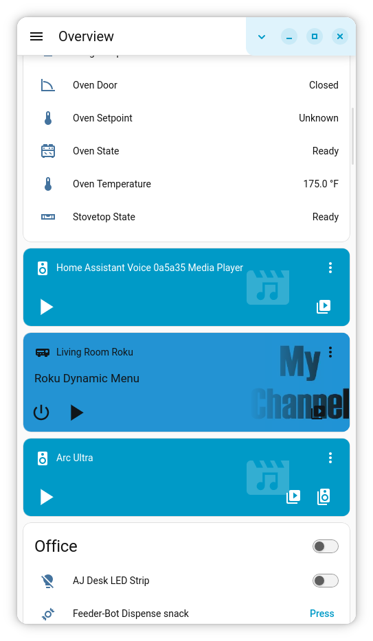
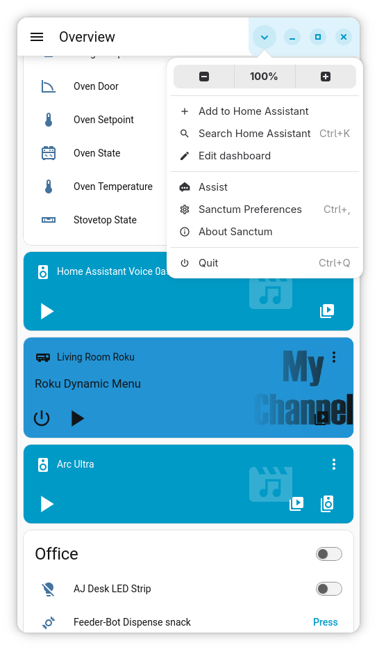
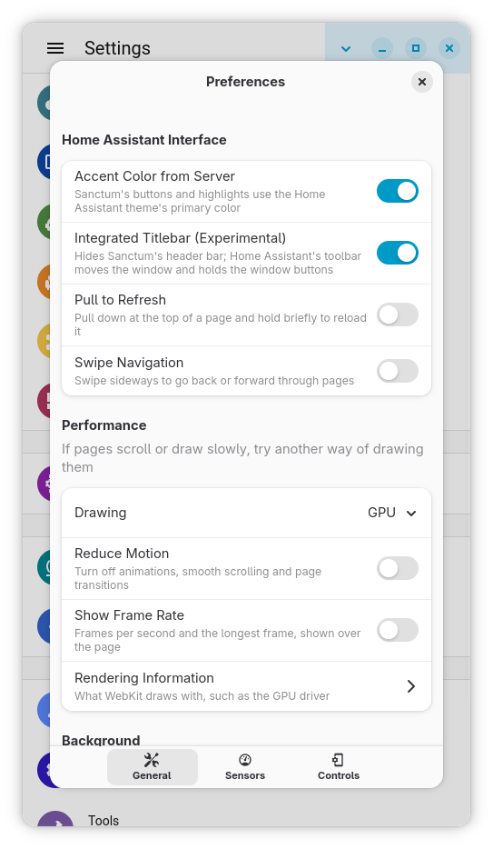
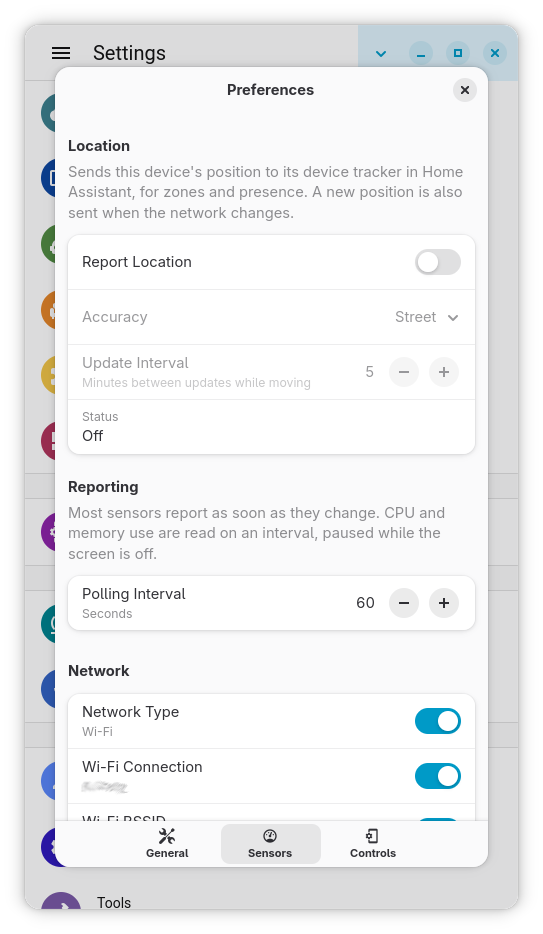
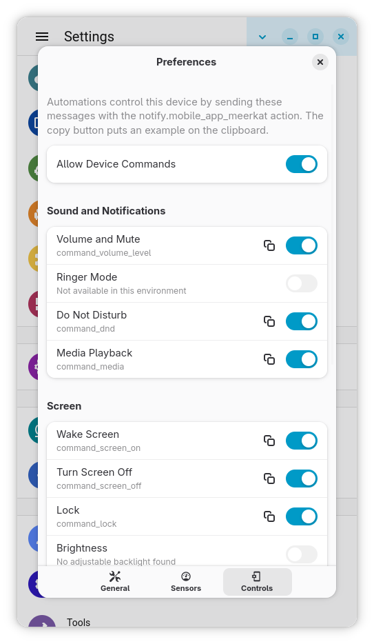
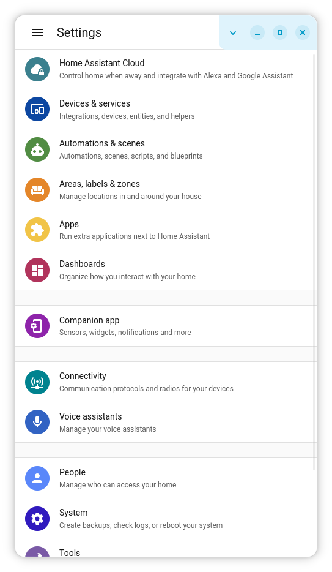
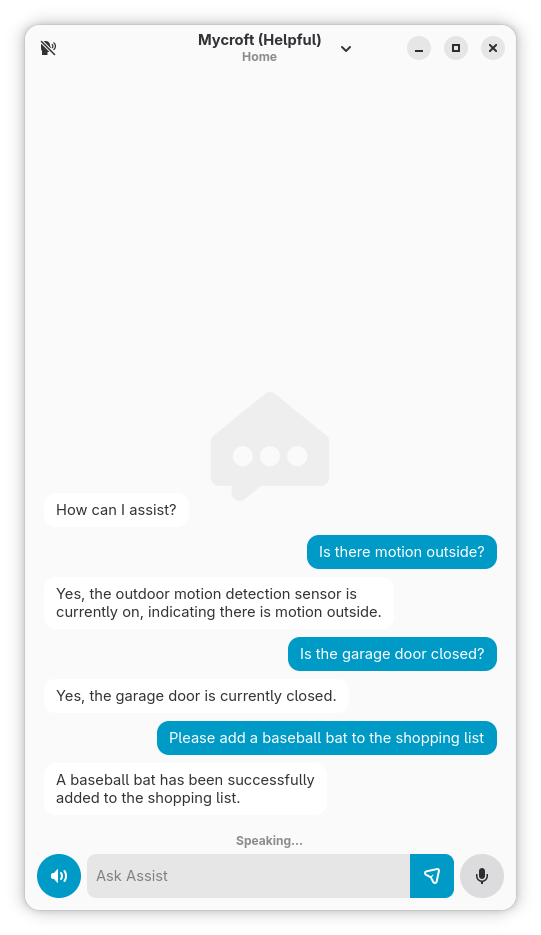

# Sanctum

An adaptive GTK4/libadwaita Home Assistant companion for Linux phones, tablets and desktops.

Sanctum shows the Home Assistant frontend and adds the native companion features around it: device registration, sensors, notifications, device commands and Assist.

## Features

- Onboarding modelled on the Android app, with local server discovery, in-app login and device registration
- Use as a full companion app, or as a front end that only shows Home Assistant
- Internal and external addresses chosen by home network (Wi-Fi, connection or interface)
- Sensors: battery, network, mobile signal, screen, session lock, CPU, memory, media and opt-in location
- Notifications with images, actions, tags and click targets
- Device commands from automations: volume, screen, brightness, flashlight, ringer mode, Do Not Disturb, media and Bluetooth
- Assist by text or voice, with spoken replies, conversation mode and an optional launcher of its own
- FuriOS assistant button binding
- QR and barcode scanning for adding devices
- Entity detail sheets with controls and a 24 hour history graph
- Optional integrated titlebar, pull to refresh and swipe navigation
- Self-signed certificates pinned per host

## Screenshots

<p align="center">
  
  
</p>

<p align="center">
  
  
  
</p>

<p align="center">
  
  
</p>

## Installing

### Flatpak (recommended)

| <a href="https://ajdunevent.github.io/AJHub/"><picture><source media="(prefers-color-scheme: dark)" srcset="https://ajdunevent.github.io/AJHub/badges/button-dark.svg"></picture></a> | <a href="https://furihub.github.io/repo/"><picture><source media="(prefers-color-scheme: dark)" srcset="https://furihub.github.io/repo/badges/button-dark.svg"></picture></a> |
| --- | --- |
| x86_64 & aarch64 | aarch64 only |

## Command line Options

| Option | Effect |
| --- | --- |
| `--assist`, `-a` | Open only the Assist window |
| `--voice` | With `--assist`, start listening |
| `--background`, `-b` | Start without a window (used by Start at Login) |

## Device commands

Send these as the `message` of a `notify.mobile_app_<device>` action, with the value in `data.command`. Names follow the Android app; levels are percentages.

| Message | `data.command` |
| --- | --- |
| `command_volume_level` | `0` to `100`, `mute`, `unmute`, `toggle_mute` |
| `command_ringer_mode` | `normal`, `vibrate`, `silent` |
| `command_dnd` | `off`, `priority_only`, `alarms_only`, `total_silence` |
| `command_media` | `media_command`: `play`, `pause`, `play_pause`, `next`, `previous`, `stop`; optional `media_package_name` |
| `command_screen_on`, `command_screen_off`, `command_lock` | |
| `command_screen_brightness_level` | `0` to `100` |
| `command_screen_off_timeout` | Milliseconds, `0` for never |
| `command_flashlight`, `command_bluetooth` | `turn_on`, `turn_off`, `toggle` |
| `command_update_sensors`, `command_stop_tts` | |
| `command_webview` | `entityId:light.kitchen`, a dashboard path or a URL |

```yaml
action: notify.mobile_app_furiphone
data:
  message: command_flashlight
  data:
    command: toggle
```

Do Not Disturb and the screen timeout need permissions the manifest leaves out. The Controls section of Preferences shows the `flatpak override` command for each.

## Permissions

| Permission | Used for |
| --- | --- |
| `--share=network` | Home Assistant |
| `--share=ipc`, `--socket=wayland`, `--socket=fallback-x11`, `--device=dri` | Display |
| `--socket=pulseaudio` | Voice Assist and volume |
| `--system-talk-name=org.freedesktop.NetworkManager` | Network sensors and home network detection |
| `--system-talk-name=org.freedesktop.Avahi` | Server discovery during setup |
| `--system-talk-name=org.freedesktop.UPower` | Battery sensors |
| `--system-talk-name=org.freedesktop.ModemManager1` | Mobile network sensors |
| `--system-talk-name=org.freedesktop.login1` | Session lock, brightness and flashlight |
| `--system-talk-name=org.bluez` | Bluetooth |
| `--talk-name=org.gnome.Mutter.DisplayConfig` | Screen state and screen commands |
| `--talk-name=io.FuriOS.AssistantButton` | FuriOS assistant button |
| `--talk-name=io.furios.Flashlightd` | Flashlight on FuriOS |
| `--talk-name=org.sigxcpu.Feedback` | Ringer mode and haptics |
| `--talk-name=org.mpris.MediaPlayer2.*` | Media sensor and command |
| `--filesystem=xdg-config/assistant-button:create` | Binding Assist to the assistant button |

Location, notifications, the camera, the keyring, background running and links use portals.

## License

GPL-3.0-or-later

Entity icons come from [Material Design Icons](https://pictogrammers.com/library/mdi/) (Apache-2.0). Only the icons listed in `build-aux/mdi-icons.txt` are bundled.